```{r setup, include=FALSE}
knitr::opts_chunk$set(echo = TRUE, fig.width = 6, fig.height = 4, fig.align = "center")
library(ggplot2)
library(tidyr)
library(patchwork)
```

::: {style="background-color: #86CBBB; 1px; height:3px "}
:::

# 1. Introduction

**Data visualization** refers to the techniques used to communicate data
or information by encoding it as visual objects (e.g., points, lines or
bars) contained in **graphics**. According to [Friedman
(2008)](https://www.smashingmagazine.com/2008/01/monday-inspiration-data-visualization-and-infographics/)
the main goal of data visualization is to **communicate information
clearly** and **effectively** through graphical means.

According to Friedman, that does not mean that data visualization needs
to look ***boring*** to be functional or extremely sophisticated to look
***beautiful***. To convey ideas effectively, both aesthetic form and
functionality need to go hand in hand. However, designers often fail to
achieve a balance between form and function, creating gorgeous data
visualizations which fail to serve their main purpose: to communicate
information ([Friedman
2008](https://www.smashingmagazine.com/2008/01/monday-inspiration-data-visualization-and-infographics/)).

::: {style="background-color:#FFDAA1"}
<i class="fa fa-key"></i> **Key concept**<br> Graphs are a great tool to
explore the data and they are essential for presenting results. Their
main goal is to communicate information clearly and efficiently to
users. Visualization is one of the steps in data analysis or data
science.
:::

Each new visualization can give us **insights** about our data. Some of
this **revealing information** may already be known (but perhaps not yet
demonstrated), while other aspects may be completely new to us. The
figure below represents the process of searching for new insights in
the data ([Aisch
2019](https://interactivos.lanacion.com.ar/manual-data/entender_los_datos_7.html)).

<center>

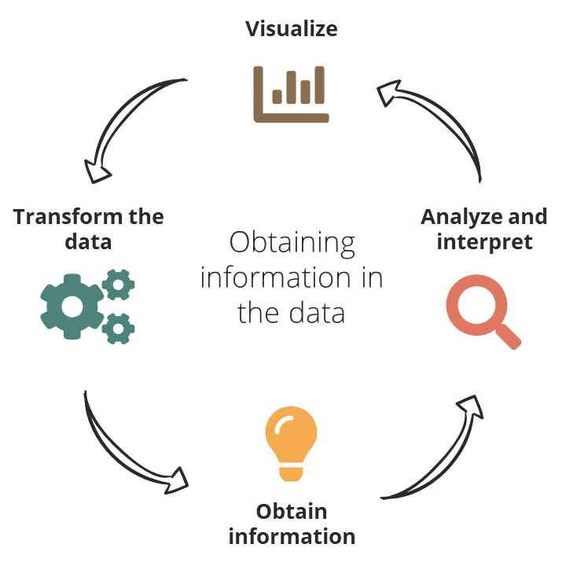

</center>

#### P2 Learning outcomes

-   Learn the grammar of graphics of `ggplot2`

-   Create the most common bioinformatic graphs (scatter plots, line
    plots, bar plots, ...)

-   Distinguish graphic quality indicators

    -   Integrity
    -   Chartjunk
    -   Data-ink ratio

-   Learn the characteristics of effective graphic displays

-   Choose a representation that shows the raw data, including paired
    designs

-   Prepare publication-ready figures (multi-panel, resolution, size)

## 1.1 Practicals organization

In this practical, we are going to use the
[**RStudio**](https://posit.co/products/open-source/rstudio/) integrated
development environment (IDE) for R. R is a programming language for
statistical computing and graphics.

<center>

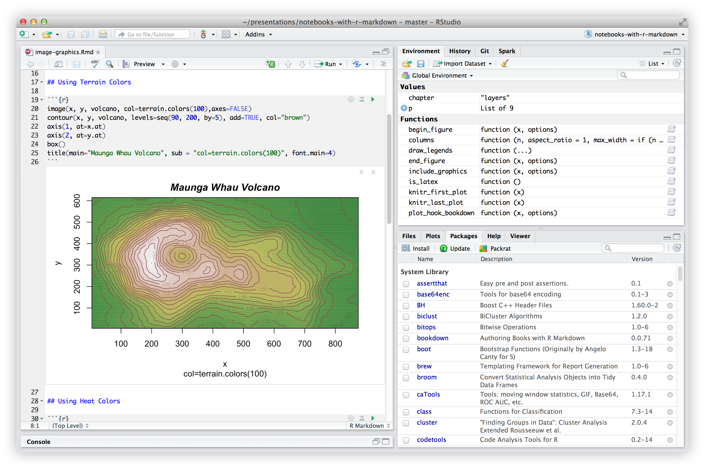

</center>

The current document in which we are working is an **R Markdown**
document. Similar to a Jupyter Notebook, R Markdown documents are fully
reproducible and allow you to combine text, images and code --in this
case, in the R programming language.

To **render** an R Markdown document to an HTML file, you just need to
click the `Knit` button that you'll see in the RStudio bar. This HTML
file can be shared as a report.

You don't need to render the whole document every time you want to see
the result of your R code. You can click on the `Run current chunk`
button or use the keyboard shortcut `Ctrl`+`Alt`+`C` and the result of
the code will appear below it.

<center>

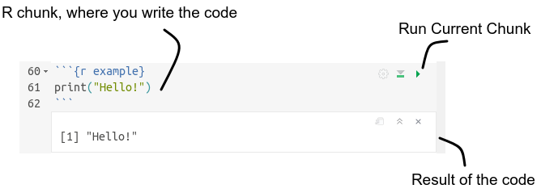

</center>

You will see different icons throughout the document, with the
following meaning:

<i class="fas fa-info-circle"></i>: additional or useful information<br>
<i class="fas fa-search"></i>: a worked example<br>
<i class="fa fa-cogs"></i>: a practical exercise<br>
<i class="fas fa-comment-dots"></i>: a space to answer the exercise<br>
<i class="fa fa-key"></i>: a hint to solve an exercise<br>
<i class="fa fa-rocket"></i>: a more challenging exercise<br><br>

::: {style="background-color: #86CBBB; 1px; height:3px "}
:::

# 2. Tools installation

We strongly recommend using a **Linux** operating system and getting
used to working with the **terminal**. In this practical, though, we
won't use it, and there's almost no difference between using RStudio
on Windows or on Linux.

## 2.1 Installing R

The R programming language can be downloaded from
[here](https://cran.rediris.es/), and is available for Windows, Linux
and macOS.

## 2.2 Installing RStudio

RStudio is available to download from
[here](https://posit.co/download/rstudio-desktop/). You can easily
install it on Windows, Linux and macOS.

## 2.3 Installing a package

R packages are collections of functions and/or data developed by the
community.

To install a package, we use the `install.packages()` function,
indicating between quotes the name of the package we want to install.

### 2.3.1 Installing `ggplot2`

`ggplot2` is a data visualization package for the statistical
programming language R ([Wickham
2009](https://www.springer.com/gp/book/9780387981413)). It was created
by Hadley Wickham, implementing Leland Wilkinson's Grammar of Graphics
--a general scheme for data visualization which breaks up graphs into
semantic components ([Wilkinson
2010](https://onlinelibrary.wiley.com/doi/full/10.1002/wics.118)).

To install the `ggplot2` package, use the following:

> `install.packages("ggplot2")`

In this practical we will also use two additional packages: `tidyr`, to
reshape data, and `patchwork`, to combine several plots into one figure:

> `install.packages(c("tidyr", "patchwork"))`

## 2.4 Loading a package

To load a package, we use the function `library()`, indicating the name
of the package we want to load.

In the case of `ggplot2`, you'll use:

> `library("ggplot2")`

You're ready to start creating graphs!

```{r example, echo = FALSE}
# Simulate data
set.seed(170513)
n <- 5000
d <- data.frame(a = rnorm(n))
d$b <- .4 * (d$a + rnorm(n))

# Compute first principal component
d$pc <- predict(prcomp(~a+b, d))[,1]

# Plot
ggplot(d, aes(a, b, color = pc)) +
  geom_point(shape = 16, size = 5, show.legend = FALSE, alpha = 0.4) +
  theme_minimal() +
  scale_color_gradient(low = "#0091FF", high = "#F0650E") + labs(x = "", y = "") +
  scale_x_continuous(breaks = round(seq(-2,2, by = 1),0))
```

::: {style="background-color: #86CBBB; 1px; height:3px "}
:::

# 3. Data visualization theory

There is grounded theory about data visualization ([Ortiz
2014](https://tereom.github.io/est-computacional-2018/)). This section
highlights the pioneering contribution of the work of **Edward Tufte**
(1942--), American statistician and professor emeritus of political
science, statistics, and computer science at Yale University. One of the
central ideas of Tufte's work refers to the **removal of non-useful
elements** in the graphics, as they distract attention from the
explanatory elements. He coined the word **chartjunk** to refer to these
useless, non-informative, or information-obscuring elements ([Minguillon
2016](http://openaccess.uoc.edu/webapps/o2/handle/10609/57624)). In
contrast, the concept of **excellence** was defined as the
**communication of complex ideas with clarity, precision and
efficiency** ([Minguillon
2016](http://openaccess.uoc.edu/webapps/o2/handle/10609/57624)).

## 3.1 Graphic quality indicators

Applicable to any graphic. These are concrete and relatively objective
guides to assess the quality of a graph ([Tufte,
2001](https://www.edwardtufte.com/tufte/books_vdqi)).

::: {style="background-color:#FFDAA1"}
-   **Graphical integrity**: refers to how accurately the visual
    elements represent the data. The lie factor, how much a graphic
    deviates from the actual data, should be minimized.
-   **Chartjunk**: minimize the use of graphic decoration that
    interferes with the interpretation of the data: 3D effect,
    patterns...
-   **Data-ink ratio**: maximize the data ink vs. total ink used to
    print the graphic.
:::

### 3.1.1 Lie factor, chartjunk and pies

<center>

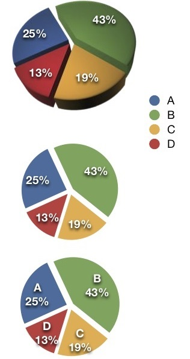

</center>

The **lie factor** is the ratio of the size of an effect shown in the
graphic to the size of the effect in the data. Ideally, the lie factor
should be 1 (no distortion).

**Chartjunk** refers to unnecessary or confusing visual elements in
graphs that are not needed to understand the information represented,
or that distract the viewer from this information.

A popular design that qualifies as chartjunk and introduces lie factors
is the **3D pie**. In the figure, we can see how segment C looks bigger
than B, although it is not the case (lie factor). The reason is the
variation in the perspective that does not correspond to variation in
the data (chartjunk).

If we correct by removing the 3D effect, the lie factor is reduced, but
there are still elements that can improve the understanding of the
graph: the relation between the colour, the quantification and the
category. We can add tags as shown in the series on the right, but then:
why not simply show the data in a table? What does the pie graph add to
the interpretation? This could be more difficult if, for example, more
categories are added.

### 3.1.2 Data-ink ratio

Maximizing the proportion of **data-ink** in our graphs has immediate
benefits. The rule is: **if there is ink that does not represent
variation in the data, or the removal of that ink does not represent
loss of meaning, that ink must be removed**.

$$ Data\text{-}ink\;ratio\;=\;\frac{Data\text{-}ink}{Total\;ink\;used\;to\;print\;the\;graphic}  $$

According to the Tufte principle, the data must be displayed above all,
so that everything that does not provide information must be deleted
(including background color, borders, grids, ...).

<center>

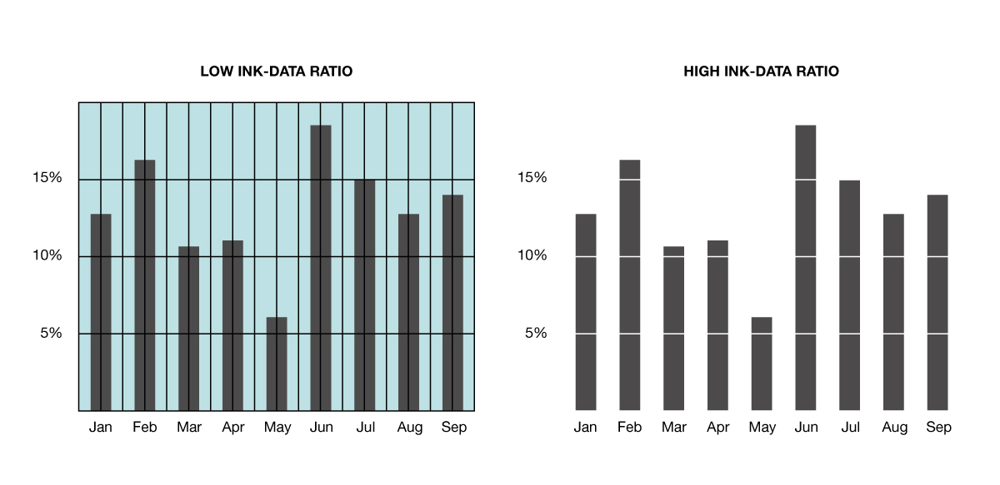

</center>

## 3.2 Characteristics of effective graphic displays

As we have previously introduced, Tufte defined the term excellence in
data visualization as communicating complex ideas with clarity,
precision and efficiency. A good visualization should:

-   Show the data
-   Induce the viewer to think about the substance rather than about
    methodology, graphic design, the technology of graphic production or
    something else
-   Avoid distorting what the data has to say (use fair axes, avoid
    using more than one `y` axis)
-   Present many numbers in a small space
-   Make large datasets coherent
-   Encourage the eye to compare different pieces of data
-   Reveal the data at several levels of detail, from a broad overview
    to the fine structure
-   Serve a reasonably clear purpose: description, exploration,
    tabulation or decoration
-   Be closely integrated with the statistical and verbal descriptions
    of a dataset

::: {style="background-color: #86CBBB; 1px; height:3px "}
:::

# 4. The grammar of graphics

In a natural language, there is a series of rules that organize words
into sentences: the grammar. [Wilkinson
(2005)](https://www.springer.com/gp/book/9780387245447) created a
grammar of graphics which offers us the basic elements to build them.

The **components** (or layers) of the grammar of graphics are:

-   The **data** that you want to visualize
-   A set of **aesthetic mappings** (`aes`) describing how variables in
    the data are mapped to aesthetic attributes that you can perceive
-   The **scales** map values in the data space to values in an
    aesthetic space, whether it be colour, or size, or shape. Scales
    draw a legend or axes, which provide an inverse mapping to make it
    possible to read the original data values from the graph
-   **Statistical transformations** (`stat`) summarise data in many
    useful ways. For example, binning and counting observations to
    create a histogram, or summarising a 2D relationship with a linear
    model
-   **Geometric objects** (`geom`) represent what you actually see on
    the plot: points, lines, polygons, etc.
-   A **coordinate system** (`coord`) describes how data coordinates
    are mapped to the plane of the graphic. It also provides axes and
    grid lines to make it possible to read the graph. We normally use a
    Cartesian coordinate system, but a number of others are available,
    including polar coordinates and map projections
-   A **faceting** describes how to break up the data into subsets and
    how to display those subsets as small multiples

<center>

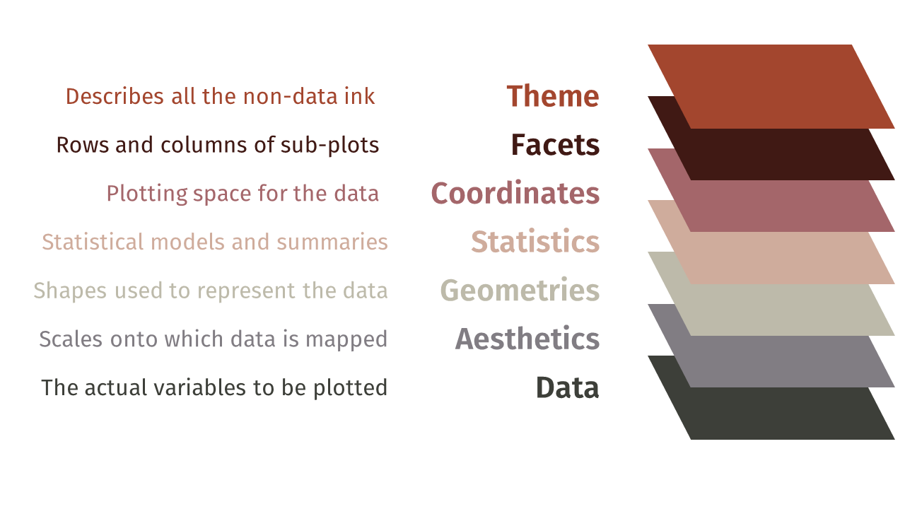

</center>

::: {style="background-color: #86CBBB; 1px; height:3px "}
:::

# 5. First steps with `ggplot2`

The following examples will walk you through the basic components of the
`ggplot2` grammar. The examples use data from the `datasets` package,
which is already loaded by default in the `R` session, as well as some
datasets loaded with the `ggplot2` package. `ggplot2` requires data to
be stored in **data frames** and in a **tidy format** (one observation
per row and one variable per column):

```{r}
head(iris)
class(iris)
```

### Wide vs. long format

Data are often stored in a **wide** format, where the same variable is
spread across several columns. For example, the expression of three
genes measured in two conditions:

```{r wide-data}
expr_wide <- data.frame(gene    = c("BRCA1", "TP53", "MYC"),
                        control = c(5.2, 8.1, 3.4),
                        treated = c(7.9, 8.3, 9.6))
expr_wide
```

Here `control` and `treated` are not two different variables: they are
two values of the same variable (the **condition**), and the values in
the cells are all **expression** measurements. To map the condition to
an aesthetic (e.g., `x` or `colour`) `ggplot2` needs it as a single
column. The function `pivot_longer()` from the `tidyr` package
transforms the data into a **long** (tidy) format:

```{r long-data}
expr_long <- pivot_longer(expr_wide,
                          cols      = c(control, treated),
                          names_to  = "condition",
                          values_to = "expression")
expr_long
```

Now each row is one observation (one gene in one condition) and we can
plot it:

```{r long-plot}
ggplot(data = expr_long, mapping = aes(x = gene, y = expression, fill = condition)) +
  geom_col(position = "dodge")
```

::: {style="background-color:#FFDAA1"}
<i class="fas fa-info-circle"></i> If you ever get stuck trying to plot
two columns at the same time, the solution is usually to transform the
data to the long format first. The opposite operation is done with
`pivot_wider()`.
:::

------------------------------------------------------------------------

## <i class="fas fa-search"></i> Example 1 \| Creating a scatter plot

### **1a** \| Basic scatter plot

For the first problem we want to represent the **relationship** between
the variables `Sepal.Width` and `Sepal.Length` from the `iris` data
frame. This data frame is a collection of data that quantifies the
morphologic variation of **iris flowers** of three related species
(setosa, versicolor and virginica).

<center>

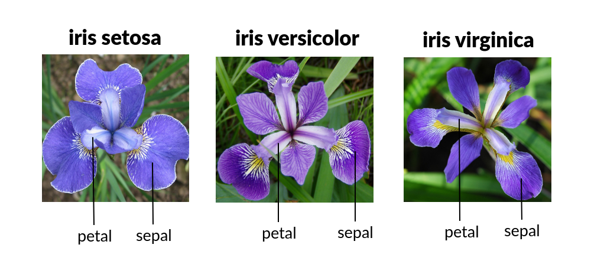

</center>

::: {style="background-color:#FFDAA1"}
<i class="fas fa-info-circle"></i> This famous (Fisher's or Anderson's)
`iris` dataset gives the measurements in centimeters of the variables
sepal length and width and petal length and width, respectively, for 50
flowers from each of 3 species of iris. You can type `?iris` in the `R`
console to read a description of the data.
:::

To represent any graph in `ggplot2` we need two basic functions that are
combined with a `+` sign:

```{r scatter-ggplot2}
ggplot(data = iris, mapping = aes(x = Sepal.Width, y = Sepal.Length)) +
  geom_point()
```

The variables that we want to represent are wrapped within an `aes()`
function, that specifies the ***mapping*** between the variables and the
***aesthetic attributes*** (in this case we map them to spatial
positions, `x` and `y`). We call the variables directly by their names,
because we also pass the entire data frame to the call with the `data`
argument, so `ggplot` knows where to get them from. Finally, we need to
add the ***geometric object*** we want to represent. In this case,
points.

### **1b** \| Represent extra variables

Another variable in the data indicates the species (`Species`) of each
flower. There are three species: setosa, versicolor and virginica.

```{r table-species}
table(iris$Species)
```

Let's say we want to represent the different species in different
colours. In this case we want to use `Species` as a **categorical
variable**, i.e., as a factor. By default, this variable is already a
factor:

```{r check-class}
class(iris$Species)
```

We use `Species` in the `colour` aesthetic:

```{r groups-ggplot2}
ggplot(data = iris, mapping = aes(x = Sepal.Width, y = Sepal.Length, colour = Species)) +
  geom_point()
```

::: {style="background-color:#FFDAA1"}
<i class="fas fa-info-circle"></i> Note that `ggplot` adds a **legend**
by default for all the variables that have been mapped to some aesthetic
attribute. This way we can read all the variables without extra effort.
:::

### <i class="fa fa-cogs"></i> Exercise

Try mapping `Species` to another aesthetic attribute instead of
`colour`, such as `shape`, `size` or `alpha`. Are you getting any
warning message? Why?

::: {style="background-color:#F0F0F0"}
##### <i class="fas fa-comment-dots"></i> Answer:

```{r answer1.1}

```
:::

------------------------------------------------------------------------

## <i class="fas fa-search"></i> **Example 2** \| Creating a bar plot

For this second exercise we are going to use the `mtcars` dataset, which
contains information about the **fuel consumption and 10 aspects of
automobile design and performance for 32 automobiles**.

```{r}
head(mtcars)
class(mtcars)
```

::: {style="background-color:#FFDAA1"}
<i class="fas fa-info-circle"></i> The data was extracted from the 1974
Motor Trend US magazine, and comprises fuel consumption and 10 aspects
of automobile design and performance for 32 automobiles (1973--74
models). You can type `?mtcars` in the `R` console to read a
description of the data.
:::

One of the variables of interest in the data indicates the number of
cylinders of the car engines (`cyl`). There are cars with 4, 6 or 8
cylinders.

### **2a** \| Basic bar plot

We want to summarize this data in a simple **bar plot** representing the
number of cars in each cylinder category; i.e., how many cars have 4, 6
or 8 cylinders. However, the number of cars with 4 cylinders is not a
piece of information present in the dataset, for example. To know the
number it is necessary to count the rows where `cyl = 4`, and we are not
going to do it by hand <i class="fas fa-smile-wink"></i>.

`ggplot2` is capable of doing simple summary operations with the input
variables, referred to as **statistical transformations**. One of them
is to count the occurrences of each value in a variable, which is
precisely what we want to do. And the `geom_bar` function happens to use
the `count` statistical transformation by default on the variable mapped
to the `x` axis.

The first thing that we are going to do is to check the class of the
`cyl` variable:

```{r class-cyl}
# First we check the class of cyl
class(mtcars$cyl)
```

We see that it's a numeric variable. In this case we want to use `cyl`
as a categorical variable, distinguishing groups rather than indicating
a value in a numerical continuous scale. For that, we need to change its
class before giving it to `ggplot` using the `as.factor()` function.

```{r factor-cyl}
# We create a new variable in the data frame, cyl_f, that is cyl converted to factor
mtcars$cyl_f <- as.factor(mtcars$cyl)
```

Now we can create the bar plot:

```{r barplot-ggplot2}
ggplot(data = mtcars, mapping = aes(x = cyl_f)) +
  geom_bar()
```

Imagine that we already have a table with the number of cars in each
cylinder category. If we had a precomputed data frame with `cyl` and
`number_of_cars` instead, we could pass the `number_of_cars` variable to
the `geom_col` function instead of `geom_bar`, which by default takes
the variables mapped to `x` and `y` without transformation.

```{r barplot-table}
# Let's create the data frame
counts_by_cyl_data_frame <- as.data.frame(table(mtcars$cyl))
names(counts_by_cyl_data_frame) <- c("cyl", "number_of_cars")

# See the data frame
counts_by_cyl_data_frame

# New graph with geom_col
ggplot(data = counts_by_cyl_data_frame, mapping = aes(x = cyl, y = number_of_cars)) +
  geom_col()
```

::: {style="background-color:#FFDAA1"}
<i class="fas fa-hand-point-up"></i> We'll use `geom_bar` if the dataset
is not processed and we need to count the occurrences of a category. If
we have a processed dataset with the counts, we'll use `geom_col`.
:::

### **2b** \| Groups and position

We have seen in the scatter plot example how to represent groups encoded
in extra variables as colours. Say we now want to show transmission type
(`am`) in the bar plot, in addition to the number of cylinders. We can
map `am` to the filling colour of the bars, `fill` (the `colour`
aesthetic would change the edges of the rectangles). There are two types
of transmission: `0` for automatic cars and `1` for manual cars.

```{r groups-bar}
# First we check the class of the variable
class(mtcars$am)

# We make am a factor, and we can change the 0/1 notation for a more informative notation: automatic/manual
mtcars$am_f <- factor(mtcars$am, levels = c(0, 1), labels = c("automatic", "manual"))

# Plot
ggplot(data = mtcars, mapping = aes(x = cyl_f, fill = am_f)) +
  geom_bar()
```

Each geometric object in `ggplot2` also has a **position** argument that
controls how groups are arranged. In `geom_bar` the default position is
to stack the groups. We can change it to a side-by-side position with
`position = "dodge"`.

```{r position-bar-ggplot2}
ggplot(data = mtcars, mapping = aes(x = cyl_f, fill = am_f)) +
  geom_bar(position = "dodge")
```

### <i class="fa fa-cogs"></i> Exercise

Update the plot above with the `"fill"` position adjustment instead of
`"dodge"`. What is it doing?

::: {style="background-color:#F0F0F0"}
##### <i class="fas fa-comment-dots"></i> Answer:

```{r answer2.1}

```
:::

Update the previous plot to group by the variable `gear` instead of the
transmission type (`am_f`). The `gear` variable is the number of forward
gears: cars can have 3, 4 or 5 gears. Check if you need to transform
`gear` to a factor.

::: {style="background-color:#F0F0F0"}
##### <i class="fas fa-comment-dots"></i> Answer:

```{r answer2.2}

```
:::

------------------------------------------------------------------------

## <i class="fas fa-search"></i> **Example 3** \| Showing the distribution of a variable: histograms

### **3a** \| Simple histogram

Now we have a new dataset called `diamonds` and we need to understand
the distribution of some of its continuous variables. A good place to
start is a histogram, which represents the number of observations in
different ranges as bars.

```{r}
head(diamonds)
class(diamonds)
```

::: {style="background-color:#FFDAA1"}
<i class="fas fa-info-circle"></i> `diamonds` is a dataset containing
the prices and other attributes of almost 54,000 diamonds. You can type
`?diamonds` in the `R` console to read a description of the data.
:::

The function that we need is called `geom_histogram()` and has the
statistical transformation `bin` by default. In this case, `bin` divides
the variable mapped to `x` into ranges (bins) and counts the number of
values in each bin. The width of the bins is controlled with the
argument `binwidth` (alternatively, you can set the number of bins with
`bins`). In this example we show the distribution of the weights of
diamonds (`carat`).

```{r histogram}
ggplot(data = diamonds, mapping = aes(x = carat)) +
  geom_histogram(binwidth = 0.3)
```

::: {style="background-color:#FFDAA1"}
<i class="fas fa-info-circle"></i> Note that histograms deal with
*continuous* variables while bar plots deal with *discrete* ones, but
they are sometimes
[confused](https://www.google.com/search?q=histograms+and+bar+graphs+difference).
:::

### **3b** \| Multiple histograms

The `diamonds` dataset contains more information about diamonds, such as
the quality (`cut`) or the color (`color`). To compare the distribution
of the weight among qualities, we can try to map `cut` to the `fill`
aesthetic:

```{r histogram-fill}
ggplot(data = diamonds, mapping = aes(x = carat, fill = cut)) +
  geom_histogram(binwidth = 0.3)
```

Stacked histograms are difficult to interpret. We can use another
position instead of the default `"stack"` position. For example, using
`position = "dodge"`.

```{r histogram-dodge}
ggplot(data = diamonds, mapping = aes(x = carat, fill = cut)) +
  geom_histogram(position = "dodge", binwidth = 0.3)
```

But there's an even better option. `ggplot2` provides a simple way of
creating small multiples or **facets** with the function `facet_grid`:

```{r facets}
ggplot(data = diamonds, mapping = aes(x = carat, fill = cut)) +
  geom_histogram(position = "dodge", binwidth = 0.3) +
  facet_grid(cut ~ .)
```

### <i class="fa fa-cogs"></i> Exercise

What happens if you change the order of the `facet_grid` elements, i.e.,
`(. ~ cut)`?

::: {style="background-color:#F0F0F0"}
##### <i class="fas fa-comment-dots"></i> Answer:

```{r answer3.1}

```
:::

Which is the best subplot configuration to compare the distributions and
why?

::: {style="background-color:#F0F0F0"}
##### <i class="fas fa-comment-dots"></i> Answer:
:::

------------------------------------------------------------------------

## <i class="fas fa-search"></i> **Example 4** \| Showing the distribution of a variable: boxplot

### **4a** \| Simple boxplot

Another way of showing the distribution of numerical data is by means of
a boxplot. It helps to understand the skewness of the data by
displaying the median and the quartiles. It also shows outliers as
separate dots.

The function that we are going to use is `geom_boxplot()`. In this
example we show the distribution of the weights of diamonds (`carat`).

```{r boxplot}
ggplot(data = diamonds, mapping = aes(y = carat)) +
  geom_boxplot()
```

One characteristic of boxplots is that you can show the distribution of
one variable (`carat`) with respect to another categorical variable. For
example, we can show the distribution of `carat` based on the color of
the diamond (`color`).

```{r boxplot2}
ggplot(data = diamonds, mapping = aes(y = carat, x = color)) +
  geom_boxplot()
```

### <i class="fa fa-cogs"></i> Exercise

Try to fill the boxes with a colour. How would you do it?

::: {style="background-color:#F0F0F0"}
##### <i class="fas fa-comment-dots"></i> Answer:

```{r answer4.1}

```
:::

### **4b** \| Show the raw data

A boxplot summarizes the distribution with five numbers. With thousands
of observations (as in `diamonds`) this is very useful, but with **small
samples** it hides how many observations there are and how they are
distributed. In biology, small samples are the rule rather than the
exception.

The `ToothGrowth` dataset contains the length of the teeth of 60 guinea
pigs that received vitamin C at three doses (`dose`) by two delivery
methods (`supp`), i.e., only 20 animals per dose. Let's compare three
ways of representing the effect of the dose:

```{r raw-data, fig.width = 9, fig.height = 3}
ToothGrowth$dose_f <- as.factor(ToothGrowth$dose)

# Boxplot only
p_box <- ggplot(data = ToothGrowth, mapping = aes(x = dose_f, y = len)) +
  geom_boxplot()

# Boxplot + raw data
p_jitter <- ggplot(data = ToothGrowth, mapping = aes(x = dose_f, y = len)) +
  geom_boxplot(outlier.shape = NA) +      # we hide the outliers, as all points will be drawn
  geom_jitter(width = 0.1, alpha = 0.6)   # jitter adds a small random horizontal shift to avoid overplotting

# Violin + raw data
p_violin <- ggplot(data = ToothGrowth, mapping = aes(x = dose_f, y = len)) +
  geom_violin() +
  geom_jitter(width = 0.1, alpha = 0.6)

p_box + p_jitter + p_violin
```

::: {style="background-color:#FFDAA1"}
<i class="fas fa-info-circle"></i> Note that we have combined several
geometric objects in the same plot: each `geom_*` is a **layer** drawn
on top of the previous one, so the order matters.
:::

A very common representation in scientific articles is the so-called
**dynamite plot**: a bar with the mean and an error bar.

```{r dynamite, fig.width = 3, fig.height = 3}
ggplot(data = ToothGrowth, mapping = aes(x = dose_f, y = len)) +
  stat_summary(fun = mean, geom = "col") +
  stat_summary(fun.data = mean_se, geom = "errorbar", width = 0.2)
```

::: {style="background-color:#FFDAA1"}
<i class="fas fa-info-circle"></i> **Avoid dynamite plots**. They show
only two numbers per group (mean and standard error), hide the sample
size and the shape of the distribution (skewness, outliers, bimodality),
and the bar suggests that the data go from 0 to the mean, which is
meaningless for a continuous variable. Very different datasets can
produce the same dynamite plot. Whenever possible, **show the data**.
:::

### <i class="fa fa-cogs"></i> Exercise

Represent the boxplot of `carat` by `color` from the `diamonds` dataset
adding the raw data with `geom_jitter()`. Is it a good idea in this
case? Why? Which representation would you choose depending on the sample
size?

::: {style="background-color:#F0F0F0"}
##### <i class="fas fa-comment-dots"></i> Answer:

```{r answer4.2}

```
:::

### **4c** \| Paired data

Sometimes the observations in two groups are not independent: the **same
individual** is measured twice (before/after a treatment, two tissues
of the same patient, ...). This is known as a **paired design**, and our
graph should reflect it.

The `sleep` dataset shows the effect of two soporific drugs (`group`)
on the extra hours of sleep (`extra`) of 10 patients (`ID`). Each patient
received both drugs.

```{r sleep-data}
head(sleep)
```

If we represent the data as two independent groups, the boxplots
overlap considerably:

```{r paired-box, fig.width = 3, fig.height = 3}
ggplot(data = sleep, mapping = aes(x = group, y = extra)) +
  geom_boxplot()
```

But we are ignoring an important piece of information: which
observations come from the same patient. We can connect them with a line
using `geom_line()` and the `group` aesthetic, which tells `ggplot2`
which points belong together. This type of graph is known as a
**slopegraph**:

```{r paired-lines, fig.width = 3, fig.height = 3}
ggplot(data = sleep, mapping = aes(x = group, y = extra)) +
  geom_line(mapping = aes(group = ID), colour = "grey60") +
  geom_point()
```

Now it is clear that **9 out of 10 patients** slept more with drug 2
than with drug 1 (and the remaining one slept the same), something that
the boxplots did not show.

::: {style="background-color:#FFDAA1"}
<i class="fas fa-info-circle"></i> Do not confuse the `group` aesthetic
(which observations are connected by a line) with the `group` column of
the `sleep` dataset (the drug). Here we use `aes(group = ID)`: one line
per patient.
:::

------------------------------------------------------------------------

## <i class="fas fa-search"></i> **Example 5** \| Customizing a plot

### **5a** \| Modify colours

So far we have used the **default colour palettes** for all our
representations. We may need to change them to make them accessible to
**colourblind people**, match the colour palette of our project or give
**meaningful values** (e.g., red for positive and blue for negative). We
can control the exact mapping of a variable to an aesthetic attribute
with the `scale_*` functions.

In the following example we manually set the colour of the five diamond
quality categories. You can use other colour names checking the
following [R color
guide](http://www.stat.columbia.edu/~tzheng/files/Rcolor.pdf).

```{r change-col-ggplot2}
ggplot(data = diamonds, mapping = aes(x = carat, fill = cut)) +
  geom_histogram(position = "dodge", binwidth = 0.3) +
  facet_grid(cut ~ .) +
  scale_fill_manual(values = c("sienna1", "orange", "lightseagreen", "orangered", "red4"))
```

::: {style="background-color:#FFDAA1"}
<i class="fas fa-info-circle"></i> Note that scale functions update both
the aesthetic mappings in the plot and in the legend.
:::

### **5b** \| Change (or add) axis, legend and plot titles

We may also need to add a **title** to the plot or change the **axis
titles**. There are several options for that:

-   In `ggplot2`, axis and legend titles can be specified with the
    `name` argument within a `scale_*` function
-   The title can be changed with `+ ggtitle("Title name")`
-   You can also use the convenience function `labs()`: with
    `fill = ""` you will set a new legend title and with `title = ""` a
    new title

See the working example:

```{r titles-ggplot2}
# We save the common part of the plot in a variable and then we can add more components with the "+" sign
p <- ggplot(data = diamonds, mapping = aes(x = carat, fill = cut)) +
  geom_histogram(position = "dodge", binwidth = 0.3) +
  facet_grid(cut ~ .)

# Option A:
p + scale_fill_manual(values = c("sienna1", "orange", "lightseagreen", "orangered", "red4"), name = "Quality") +
  scale_x_continuous(name = "Weight of the diamond") +
  ggtitle("Diamond weight variation")

# Option B:
# p + scale_fill_manual(values = c("sienna1", "orange", "lightseagreen", "orangered", "red4")) +
#   labs(title = "Diamond weight variation", x = "Weight of the diamond", fill = "Quality")
```

### **5c** \| Change theme

The appearance of `ggplot2` plots is controlled by the **themes**. The
default `ggplot2` theme has a gray background and "*is designed to put
the data forward yet make comparisons easy*". You can change the general
appearance by choosing a different theme with `theme_*` functions. There
are [eight different
themes](https://ggplot2.tidyverse.org/reference/ggtheme.html) available.
The following example uses the "black and white" theme (`theme_bw()`):

```{r theme}
ggplot(data = diamonds, mapping = aes(x = carat, fill = cut)) +
  geom_histogram(position = "dodge", binwidth = 0.3) +
  facet_grid(cut ~ .) +
  scale_fill_manual(values = c("sienna1", "orange", "lightseagreen", "orangered", "red4"), name = "Quality") +
  scale_x_continuous(name = "Weight of the diamond") +
  ggtitle("Diamond weight variation") +
  theme_bw()
```

### <i class="fas fa-cogs"></i> Exercise

Using the previous code, try other `scale_fill_*` functions in
`ggplot2` with pre-defined palettes, such as `scale_fill_hue()`,
`scale_fill_brewer()`, `scale_fill_viridis_d()` (the default for
ordered factors such as `cut`) and `scale_fill_grey()`. Which palette
would you use to ensure that colourblind people can distinguish the
colours, `scale_fill_hue()` or `scale_fill_viridis_d()`?

::: {style="background-color:#F0F0F0"}
##### <i class="fas fa-comment-dots"></i> Answer:

```{r answer5.1}

```
:::

::: {style="background-color:#FFDAA1"}
<i class="fas fa-info-circle"></i> Around 8% of men and 0.5% of women
have some form of colour vision deficiency. Besides `viridis`, the
`scale_fill_brewer(palette = "Dark2")` and `palette = "Set2"` palettes
are colourblind-friendly for categorical variables. You can check how
your figure is seen with a colour blindness simulator such as
[Coblis](https://www.color-blindness.com/coblis-color-blindness-simulator/).
:::

Try the `subtitle = ""`, `caption = ""` and `tag = ""` arguments of the
`labs()` function. What are they for?

::: {style="background-color:#F0F0F0"}
##### <i class="fas fa-comment-dots"></i> Answer:

```{r answer5.2}

```
:::

Which theme of the [eight
available](https://ggplot2.tidyverse.org/reference/ggtheme.html) do you
think maximizes the data-ink ratio?

::: {style="background-color:#F0F0F0"}
##### <i class="fas fa-comment-dots"></i> Answer:

```{r answer5.3}

```
:::

### **5d** \| Combining plots

Scientific figures often have several panels (A, B, C...). The
`patchwork` package allows combining `ggplot2` plots with simple
operators: `+` places plots side by side, `/` places them one on top of
the other, and parentheses group them.

```{r patchwork, fig.width = 8, fig.height = 5}
p1 <- ggplot(data = iris, mapping = aes(x = Sepal.Width, y = Sepal.Length, colour = Species)) +
  geom_point() +
  theme_classic()

p2 <- ggplot(data = iris, mapping = aes(x = Species, y = Petal.Length)) +
  geom_boxplot(outlier.shape = NA) +
  geom_jitter(width = 0.1, alpha = 0.5) +
  theme_classic()

p3 <- ggplot(data = iris, mapping = aes(x = Petal.Length, fill = Species)) +
  geom_histogram(binwidth = 0.2) +
  theme_classic()

(p1 + p2) / p3 + plot_annotation(tag_levels = "A")
```

::: {style="background-color:#FFDAA1"}
<i class="fas fa-info-circle"></i> When several panels share the same
legend, you can collect them into a single one with
`plot_layout(guides = "collect")`.
:::

### <i class="fas fa-cogs"></i> Exercise

Combine the plots `p_box`, `p_jitter` and `p_violin` from Example 4b in
a single column, with tags "a", "b", "c" (lowercase), and add a common
title with `plot_annotation(title = "")`.

::: {style="background-color:#F0F0F0"}
##### <i class="fas fa-comment-dots"></i> Answer:

```{r answer5.4}

```
:::

------------------------------------------------------------------------

## <i class="fas fa-info-circle"></i> Saving the plots

There are several ways to save a plot to a file. Here you have a couple
of examples:

A. Export button from the `RStudio` plot panel:

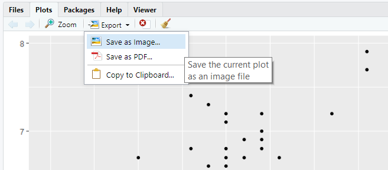

B. `ggsave` function from the `ggplot2` package

```{r ggsave, eval = FALSE}
p <- ggplot(data = iris, mapping = aes(x = Sepal.Width, y = Sepal.Length)) + geom_point()

ggsave(filename = "plot.png", plot = p, width = 6, height = 4) # In inches by default
```

When preparing a figure for a publication, journals usually ask for a
**minimum resolution** (typically 300 dpi for photographs and plots, and
600 dpi or more for line art) and a **specific size** (e.g., 85 mm for a
single column and 170 mm for a full page width). You can set both in
`ggsave()`:

```{r ggsave-publication, eval = FALSE}
ggsave(filename = "figure1.png", plot = p, width = 85, height = 70, units = "mm", dpi = 300)
```

::: {style="background-color:#FFDAA1"}
<i class="fas fa-info-circle"></i> The text size in `ggplot2` is defined
in points, independently of the size of the figure. A plot saved with
`width = 6, height = 4` (inches) and then shrunk to fit in a column will
have tiny, unreadable labels. It is better to save the figure **directly
at its final size** and adjust the text size with the theme, e.g.,
`theme_classic(base_size = 8)`.
:::

Plots can be saved using different image file formats. Option **A**
gives you the format options in a drop-down list (image format: PNG,
JPG, ...), option **B** guesses the format from the extension (e.g.
`plot.png` or `plot.pdf`).

The main formats can be classified into:

-   Raster/bitmap formats, where information is stored in pixels and
    have a maximum resolution.

    -   **PNG**: extension .png, supports transparent background, good
        lossless compression (doesn't lose quality)
    -   **JPEG**: extensions .jpg and .jpeg, very good compression, used
        in personal photography but suffers from quality degradation
        with repeated modifications
    -   **TIFF**: extensions .tif and .tiff, preferred format for
        professional printing

-   Vector formats, where information is encoded in geometric shapes
    that can be rendered at any size without losing resolution.

    -   **SVG**: extension .svg, standard for vector graphics, requires
        the `svglite` package

-   Hybrid

    -   **PDF**: can contain both vector graphics and raster images

### <i class="fas fa-cogs"></i> Exercise

Save the plot `p` in a raster and a vector format with the same size
using `ggsave()` (e.g.: `width = 6, height = 4`). What differences do
you observe when you zoom in on them?

<i class="fas fa-info-circle"></i> Note: SVG devices require the
`svglite` R package and other system libraries (`libcairo2-dev` and
`libfontconfig1-dev`). If you get an error, use PDF as the vector
format instead.

::: {style="background-color:#F0F0F0"}
##### <i class="fas fa-comment-dots"></i> Answer:

```{r answer6.1}

```
:::

------------------------------------------------------------------------

## <i class="fa fa-cogs"></i> Wrap up exercise

If we use `geom_point()` to represent a scatter plot and `geom_bar()`
for a bar plot... could you guess how to represent a **line** plot with
`ggplot2` syntax?

-   Represent how the `unemploy` variable changes over time (`date`
    variable) from the `economics` dataset with a line plot using
    `ggplot2` syntax
-   Modify axis names and add a title
-   Use a theme
-   Save the plot to a file using a raster image format (PNG)

::: {style="background-color:#F0F0F0"}
##### <i class="fas fa-comment-dots"></i> Answer:

```{r wrap-exercise-line-plot}

```
:::

<i class="fa fa-key"></i> The final image should look like this:

<center>

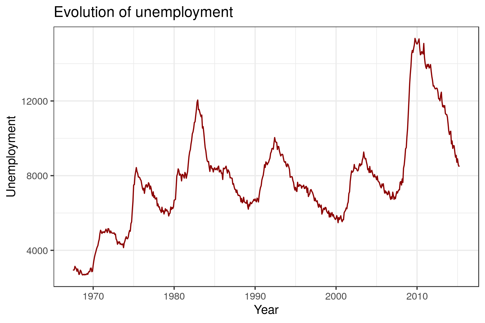

</center>

::: {style="background-color: #86CBBB; 1px; height:3px "}
:::

# <i class="fa fa-cogs"></i> Try to reproduce a plot!

Pick one of the following plots. With your knowledge of `ggplot2`, try
to write the code that reproduces the same figure. You are given the
name of the dataset and the colour palette (or other hints).

| Group | Dataset        | Description                                                       | Hint                                                                              |
|-------|----------------|-------------------------------------------------------------------|-----------------------------------------------------------------------------------|
| 1     | `Titanic`      | Survival of passengers on the Titanic                             | Colour palette is: "#79AEB2", "#4A6274"                                           |
| 2     | `ToothGrowth`  | The effect of vitamin C on tooth growth in guinea pigs            | Colour palette is: "#58A6A6", "#EFA355"                                           |
| 3     | `msleep`       | An updated and expanded version of the mammals sleep dataset      | You can colour in gray the NA values inside the scale_fill (na.value = "grey80")  |
| 4     | `mpg`          | Fuel economy data from 1999 and 2008 for 38 popular models of car | Colour palette is: "#4CC3CD", "#FEE883"                                           |
| 5     | `midwest`      | Midwest demographics                                              | Two aesthetics are combined inside geom_point(), colour and size                  |
| 6     | `diamonds`     | Prices of 50,000 round cut diamonds                               | The viridis palette is used                                                       |
| 7     | `HairEyeColor` | Hair and eye color of statistics students                         | Colour palette is: "#58A6A6", "#EFA355"                                           |
| 8     | `infert`       | Infertility after spontaneous and induced abortion                | Colour palette is: "#900C3F", "#C70039", "#FF5733"                                |

<i class="fas fa-info-circle"></i> `Titanic` and `HairEyeColor` are
stored as tables, not data frames. Use `as.data.frame()` to convert
them before plotting.

<a href="img/titanic2020_11_7D10_3_14.png" target="new">
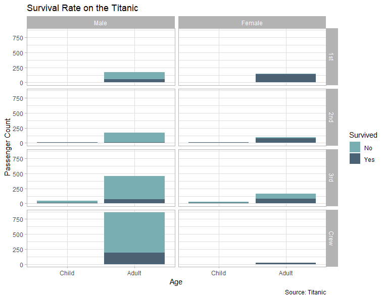
</a><a href="img/toothGrowth2020_11_7D10_6_32.png" target="new">
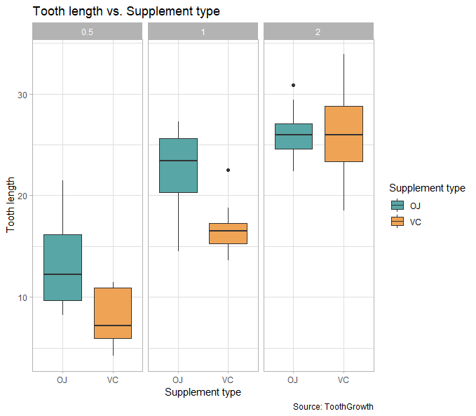
</a><a href="img/msleep2020_11_7D10_9_41.png" target="new">
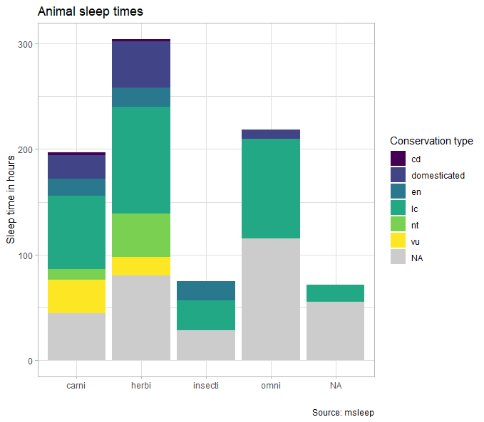
</a>
<a href="img/mpg2020_11_7D10_10_11.png" target="new">
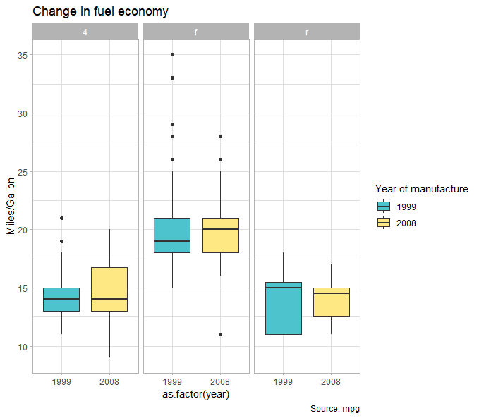
</a><a href="img/midwest2020_11_7D10_10_38.png" target="new">
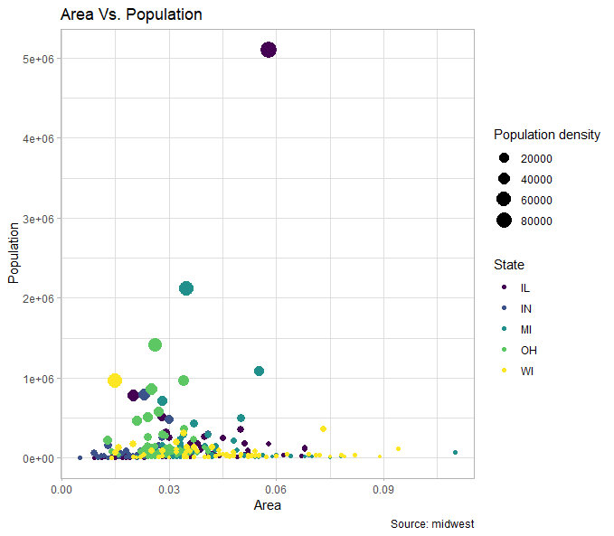
</a>
<a href="img/diamonds2020_11_7D10_11_9.png" target="new">
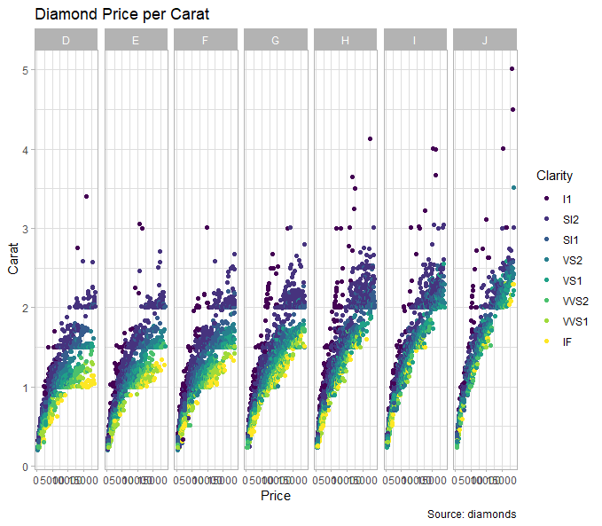
</a><a href="img/HairEyeColor2020_11_7D10_11_42.png" target="new">
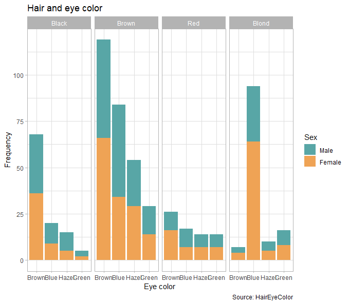
</a>
<a href="img/infert2020_11_7D10_11_54.png" target="new">
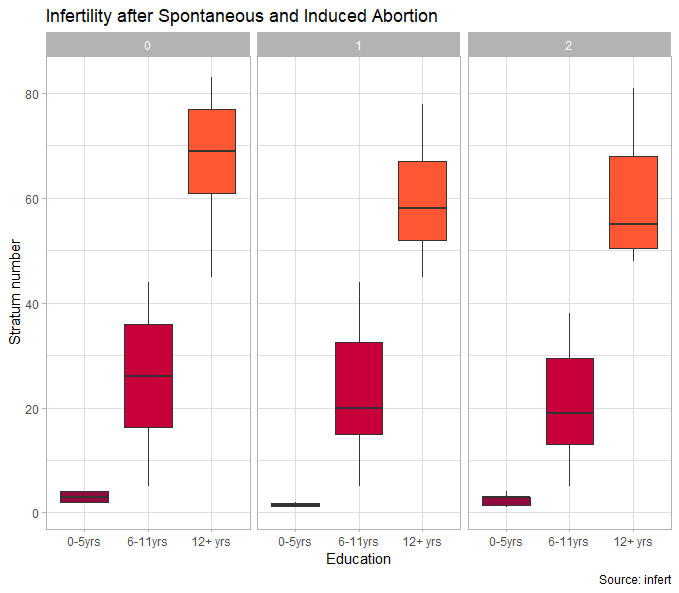
</a>

```{r reproducing-ggplot2}

```

::: {style="background-color: #86CBBB; 1px; height:3px "}
:::

# <i class="fa fa-rocket"></i> Analyze a real scientific dataset

We want to practice with real-world datasets to build our `ggplot2`
skills. Choose **one** of the following 7 datasets and explore it with
**several plots**: each dataset contains several variables, so there is
more than one interesting question to ask. For each one you have a
short description, the meaning of the variables and the original
study.

Keep in mind what we have learnt:

-   **Show the raw data**, and choose the geometry depending on the
    sample size
-   Some datasets contain **repeated measures of the same individual**
    (several measurements over time). To draw one line per individual,
    use the `group` aesthetic (Example 4c)
-   Check the **class** of each variable: some categorical variables are
    coded as **numbers** and must be transformed to factors with
    `factor()`, as we did with the transmission type (`am`) in Example 2b

All the datasets are tab-separated files (`.tsv`). You can read them
directly from the link, for example:

```{r eval = F}
data <- read.table("https://raw.githubusercontent.com/marta-coronado/TAB/main/P2_datasets/penguins.tsv", header = TRUE, sep = "\t")
```

### 1. Palmer penguins

Between 2007 and 2009, Kristen Gorman measured adult penguins of three
species (Adelie, Chinstrap and Gentoo) on three islands of the Palmer
Archipelago, Antarctica, as part of a long-term ecological research
program.

| Variable | Description |
|:--|:--|
| `species` | Adelie, Chinstrap or Gentoo |
| `island` | Biscoe, Dream or Torgersen |
| `bill_len`, `bill_dep` | bill length and depth (mm) |
| `flipper_len` | flipper length (mm) |
| `body_mass` | body mass (g) |
| `sex`, `year` | sex and year of the measurement |

<i class="fa fa-key"></i> Hint: plot bill length against bill depth for
all the penguins together. What happens when you colour the points by
species? How does body mass differ between species and sexes? Are the
three species found on all the islands?

-   [Data](https://raw.githubusercontent.com/marta-coronado/TAB/main/P2_datasets/penguins.tsv)
-   [Read the study](https://journals.plos.org/plosone/article?id=10.1371/journal.pone.0090081)

### 2. Insect biodiversity in Los Angeles

Cities are warmer, drier and their vegetation is often non-native (for
example, lawns), so urbanization could reduce insect diversity. Adams et
al. placed insect traps in sites of Los Angeles with different levels of
urbanization and counted the number of species captured in each trap
(species **richness**).

| Variable | Description |
|:--|:--|
| `Sample` | trap identifier |
| `Urban.Type` | urbanization level: `1` (natural), `3` (suburban), `8` (developed) and `9` (dense) |
| `Lawn` | whether there is a lawn next to the trap (`Yes` / `No`) |
| `Richness` | number of insect species captured |
| `Temp.Mean`, `Rh.Mean` | mean temperature (ºC) and relative humidity (%) |
| `Photoperiod` | hours of light on the sampling day |

<i class="fa fa-key"></i> Hint: `Urban.Type` is a categorical variable
coded with numbers. Check which values it takes with
`table(insects$Urban.Type)` and transform it to a factor with
informative labels, as in Example 2b:
`factor(insects$Urban.Type, levels = c(___), labels = c(___))`. How does
richness change with urbanization? And with
the presence of a lawn? Is richness related to any of the environmental
variables?

-   [Data](https://raw.githubusercontent.com/marta-coronado/TAB/main/P2_datasets/urban_insects.tsv)
-   [Read the study](https://esajournals.onlinelibrary.wiley.com/doi/10.1002/eap.2089)

### 3. Chick growth and diet

The body weight of 50 chicks was measured every two days from birth to
day 21. The chicks were fed with one of four experimental diets.

| Variable | Description |
|:--|:--|
| `Chick` | chick identifier |
| `Diet` | experimental diet (`1` to `4`) |
| `Time` | days since birth |
| `weight` | body weight (g) |

<i class="fa fa-key"></i> Hint: draw the growth curve of each chick
(one line per chick). Which diet produces the fastest growth? Do all the
chicks follow the same pattern? Do all of them reach day 21?

-   [Data](https://raw.githubusercontent.com/marta-coronado/TAB/main/P2_datasets/chick_weight.tsv)
-   Study: Crowder, M. and Hand, D. (1990). *Analysis of Repeated
    Measures*. Chapman and Hall (example 5.3).

### 4. Photosynthesis and cold tolerance

Potvin et al. studied the cold tolerance of the grass *Echinochloa
crus-galli*. They measured the CO~2~ uptake of 12 plants from two
origins (Quebec and Mississippi), half of them chilled overnight, at
seven increasing concentrations of ambient CO~2~.

| Variable | Description |
|:--|:--|
| `Plant` | plant identifier |
| `Type` | origin of the plant: Quebec or Mississippi |
| `Treatment` | `chilled` or `nonchilled` |
| `conc` | ambient CO~2~ concentration (µL/L) |
| `uptake` | CO~2~ uptake rate (µmol/m² s) |

<i class="fa fa-key"></i> Hint: draw the response curve of each plant
(uptake against CO~2~ concentration). Does chilling affect the plants of
both origins in the same way?

-   [Data](https://raw.githubusercontent.com/marta-coronado/TAB/main/P2_datasets/co2_grass.tsv)
-   [Read the study](https://doi.org/10.2307/1938276)

### 5. How fast is a drug eliminated?

The anti-asthmatic drug theophylline was given orally to 12 people, and
its concentration in blood was measured at 11 time points during the
following 25 hours (a **pharmacokinetic** study).

| Variable | Description |
|:--|:--|
| `Subject` | person identifier |
| `Wt` | body weight (kg) |
| `Dose` | dose of theophylline (mg/kg) |
| `Time` | time since the drug was given (h) |
| `conc` | theophylline concentration in serum (mg/L) |

<i class="fa fa-key"></i> Hint: draw the concentration curve of each
person. How does the concentration change over time? Try a logarithmic
scale on the `y` axis (`scale_y_log10()`): what shape does the
elimination phase have now? Does the dose explain the differences
between people?

-   [Data](https://raw.githubusercontent.com/marta-coronado/TAB/main/P2_datasets/theophylline.tsv)
-   Study: Boeckmann, A. J., Sheiner, L. B. and Beal, S. L. (1994).
    *NONMEM Users Guide: Part V*. NONMEM Project Group, University of
    California, San Francisco.

### 6. Mutations in the HIV genome

HIV evolves very fast inside each patient. Theys et al. sequenced the
virus of several patients over time and estimated, for each possible
mutation in the reverse transcriptase gene, its **mean frequency** in
the viral population. Mutations that are harmful for the virus are
removed by natural selection and remain at **low frequencies**.

| Variable | Description |
|:--|:--|
| `num` | position of the site in the sequence |
| `AAnum` | position of the amino acid in the protein |
| `TypeOfSite` | `syn` (synonymous: the amino acid does not change) or `nonsyn` (non-synonymous) |
| `WTnt` | original (wild-type) nucleotide: `a`, `c`, `g` or `t` |
| `WTAA`, `MUTAA` | original and mutated amino acid |
| `bigAAChange` | `1` if the amino acid changes drastically (e.g. in charge or size), `0` otherwise |
| `MeanFreq` | mean frequency of the mutation in the patients |
| `TSmutrate` | mutation rate of the site |
| `EstSelCoeff` | estimated cost of the mutation for the virus (selection coefficient) |

<i class="fa fa-key"></i> Hint: the frequencies vary over several
orders of magnitude, so try a logarithmic scale. Are synonymous or
non-synonymous mutations more frequent? Why? Among non-synonymous
mutations, are drastic amino acid changes less frequent? Does the
frequency depend on the original nucleotide?

-   [Data](https://raw.githubusercontent.com/marta-coronado/TAB/main/P2_datasets/hiv_mutations.tsv)
-   [Read the study](https://doi.org/10.1371/journal.pgen.1007420)

### 7. The 1918 flu pandemic

The 1918 influenza pandemic (the "Spanish flu") killed tens of millions
of people worldwide. These data are the number of deaths at each age,
in women and men.

| Variable | Description |
|:--|:--|
| `age` | age (years) |
| `femaleDeaths`, `maleDeaths` | number of deaths of women and men of that age |
| `totalDeaths` | total number of deaths |

<i class="fa fa-key"></i> Hint: to plot women and men in the same graph
(one line each), you need the data in the **long format** with
`pivot_longer()`. Which ages had more deaths? Is the pattern what you
would expect for a flu? Is it the same in women and men?

-   [Data](https://raw.githubusercontent.com/marta-coronado/TAB/main/P2_datasets/spanish_flu_1918.tsv)
-   Data from: Whitlock, M. C. and Schluter, D. (2020). *The Analysis
    of Biological Data*. Third Edition (example 10.6).

```{r analyse-dataset}

```

# <i class="fa fa-rocket"></i> Final figure

Prepare a **publication-ready figure** with one of the real datasets:

-   At least **two panels** (A, B) combined with `patchwork`. For
    example, two different representations of the same data, or two
    different variables
-   Show the raw data
-   Informative axis titles (with units) and a colourblind-friendly
    palette
-   Saved with `ggsave()` in PNG at **300 dpi** and in PDF, with a width
    of **170 mm**

```{r final-figure}

```

# Upload your results to your GitHub

Upload this Rmd document and the figures you have generated to your
GitHub repository.

::: {style="background-color: #86CBBB; 1px; height:3px "}
:::

<br>
