```{r setup, include=FALSE}
options(htmltools.dir.version = FALSE)
knitr::opts_chunk$set(
  message = FALSE,
  warning = FALSE,
  fig.retina = 5
)
#pagedown::chrome_print("TAB_Introduction.html")
```

```{r xaringan-themer, include=FALSE, warning=FALSE}
library(xaringanthemer)
style_mono_accent(
  base_color = "#1c5253", link_color =  "#DE1144", code_inline_color = "#DE1144",
  header_font_google = google_font("Josefin Sans"),
  text_font_google   = google_font("Montserrat", "400", "400i"),
  code_font_google   = google_font("Roboto Mono")
)
```

```{r xaringanExtra-clipboard, echo=FALSE}
library(xaringanExtra)
htmltools::tagList(
  xaringanExtra::use_clipboard(
    button_text = "<i class=\"fa fa-clipboard\"></i>",
    success_text = "<i class=\"fa fa-check\" style=\"color: #90BE6D\"></i>",
  ),
  rmarkdown::html_dependency_font_awesome()
)
```

class: title-tab

<div class="tt-block">
  <div class="tt-title">Introduction</div>
</div>

<div class="tt-text">
  <p class="tt-course">Current Topics in Bioinformatics (TAB)</p>
  <p class="tt-authors">Marta Coronado (<a href="mailto:marta.coronado@csic.es">marta.coronado@uab.cat</a>)</p><br>
  <p class="tt-degree">Genetics Degree | Course 2026/27</p>
</div>

<div class="tt-grid">
  <div class="tile t1"><i class="fa-solid fa-terminal"></i></div>
  <div class="tile t2"><i class="fa-solid fa-chart-column"></i></div>
  <div class="tile t3"><i class="fa-solid fa-dna"></i></div>
  <div class="tile t4"><i class="fa-solid fa-circle-nodes"></i></div>
  <div class="tile t5"><i class="fa-brands fa-github"></i></div>
  <div class="tile t6"><i class="fa-solid fa-laptop-code"></i></div>
</div>

---
class: animated, fadeIn

## Contact

<center>
**Marta Coronado Zamora**

Departament de Genètica i de Microbiologia (UAB)

<i class="fa-solid fa-paper-plane"></i> <a href="mailto:marta.coronado@uab.cat">marta.coronado@uab.cat</a><br>
<i class="fa-brands fa-bluesky"></i> @geneticament.bsky.social &nbsp; <i class="fa-brands fa-github"></i> @marta-coronado

---
class: animated, fadeIn

## Practical information

1. Check the schedule in this [link](https://web01.uab.es:31501/pds/consultaPublica/look%5Bconpub%5DInicioPubHora?entradaPublica=true) (it also includes the room)

   <div style="width:80%; margin:0 auto; height:300px; overflow:hidden; border:1px solid #ccc; border-radius:8px;"><iframe src="https://web01.uab.es:31501/pds/consultaPublica/look%5Bconpub%5DInicioPubHora?entradaPublica=true" style="width:200%; max-width:none; height:600px; border:0; transform:scale(0.5); transform-origin:0 0;"></iframe></div>

2. Check the occupancy of the computer rooms: https://sidciencies.uab.cat/gabooking/consulta_libre.php

---
class: animated, fadeIn

# Outline

#### **01 | Course organization**

Practical sessions, conferences, seminar session, methodology, evaluation, session dynamics

#### **02 | Practical contents**

Summary of the practical session's objectives and learning outcomes

#### **03 | First task: get together**

Groups organization, creation of the GitHub repository, tools

---
layout: false
class: left, bottom, inverse, animated, bounceInDown

# 01

## Course organization

Practical sessions, conferences, seminar session, methodology, evaluation, session dynamics

---
class: animated, fadeIn

## Practical sessions (12h)

**Introduction** | Presentation of **Current Topics in Bioinformatics** (Theory room C1/015, 20/10, 11:00h)

**Hands-on training** (2h/session)

.small[
| | Session | Room | Date |
|:--|:--|:--:|:--:|
| **Part 1** | **Basics on Bioinformatics workflows** | | |
| P1 | Data management and processing | PC5 | 21/10 |
| P2 | Data exploration and visualization | PC5 | 06/11 |
| | Extra time for practicals | PC1B | 09/11 |
| **Part 2** | **Solving real cases in genomics** | | |
| P3 | Differential gene expression analysis | PC5 | 18/11 |
| P4 | Single-cell analysis with Seurat | PC1B | 26/11 |
| | Extra time for practicals | PC6 | 15/12 |
]

---
class: animated, fadeIn

## Invited conferences and workshops

Attend invited conferences and workshops by experts in bioinformatics in different areas. **Format**: in-person.

.small[
| Speaker | Affiliation | Date |
|:--|:--|:--|:--:|
| **Miriam Merenciano** | Beatriu de Pinós researcher at UAB | 28/10 – 12h – C5B/007 |
| **Miquel Ràmia** | Made of genes (company) | 4/11 – 12h – C5B/007 |
| **Irepan Salvador** | Researcher at Barcelona Supercomputing Center (BSC) | 11/11 <i class="fa-solid fa-triangle-exclamation" style="color:#DE1144;"></i>: **17/11 at 10h?** |
| **Miquel Àngel Schikora** | Researcher at Barcelona Supercomputing Center (BSC) | 23/11 – 11h – C5B/007 |
| **Jose F. Sánchez** | Bioinformatician at Germans Trias i Pujol | 25/11 – 13h – C1/015 |
| **Cinta Pegueroles** | Lecturer professor at UAB | 01/12 – 11h – C1/015 |
| **Victor Fernández** | Genetics Degree alumni | 9/12 – 10h – C5B/007 |
| **Marta Coronado** | Lecturer professor at UAB | 16/12 – 10h – C1/015 |
| **WRAP UP** | | 18/12 – 10h - C1/015 |
]

<br>
> Conferences will be updated and announced through Campus Virtual.

---
class: animated, fadeIn

## Invited conferences and workshops

We will ask general questions to the speakers (**check the [Forum](https://e-aules.uab.cat/2026-27/mod/forum/discuss.php?d=11963) to participate!**)

<br>
Examples of topics you can ask about:

- Grant and funding opportunities

- Challenges of pursuing a PhD

- Working abroad vs. staying in Spain

- Differences academia vs. company

- Etc.!

---
class: animated, fadeIn

## Seminar session

**15 minutes + 5 minutes Q&A**

<i class="fa-solid fa-calendar-days"></i> 19th December, 15:30h (C5B/007)

- Each group will prepare a presentation of a bioinformatic topic of their interest

- Pick a topic from the list available at Campus Virtual, or propose any other topic

---
class: animated, fadeIn

## Methodology

.pull-left[

**Cooperative learning process**

- Groups of 3-4 students (enrollment through Campus Virtual)

- Four connected practical sessions

- Attend conferences and workshops by experts and ask questions

]

.pull-right[
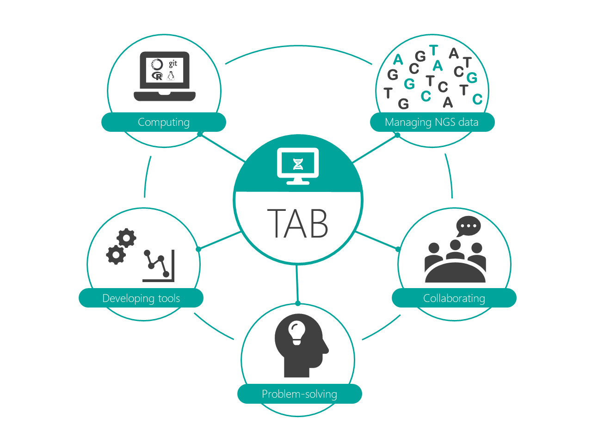
]

---
class: animated, fadeIn

## Evaluation

.pull-left[

#### Portfolio (70%)

A GitHub repository containing:

- **Personal presentation** (individual): what do I expect to learn?

- **Practical reports** (group): one report for each of the four practicals

- **Conference essays** (individual): two of the conferences you attended, including a discussion of the questions raised

- **Final reflection** (individual): what did I learn?

- **_Calaix de sastre_** (individual): miscellaneous section

]

.pull-right[

#### Seminar (20%)

- **Peer assessment:** each group grades the other groups' seminars using a rubric

- **Co-evaluation:** members of each group assess each other

- Presenting in English earns extra points

#### Attendance and participation (10%)

- Participation in the forum

- Asking questions to the invited speakers

- Any absence must be justified

]

.footnote[<i class="fa-solid fa-triangle-exclamation"></i> **Practical reports:** only students whose names appear on the submitted report will be graded for it.]

---
layout: false
class: left, bottom, inverse, animated, bounceInDown

# 02

## Practical contents

Summary of the practical session's objectives and learning outcomes

---
class: animated, fadeIn

## Practical contents

.grid-2x2[
<div>

<p><b>P1</b> | Data management and processing</p>
</div>
<div>
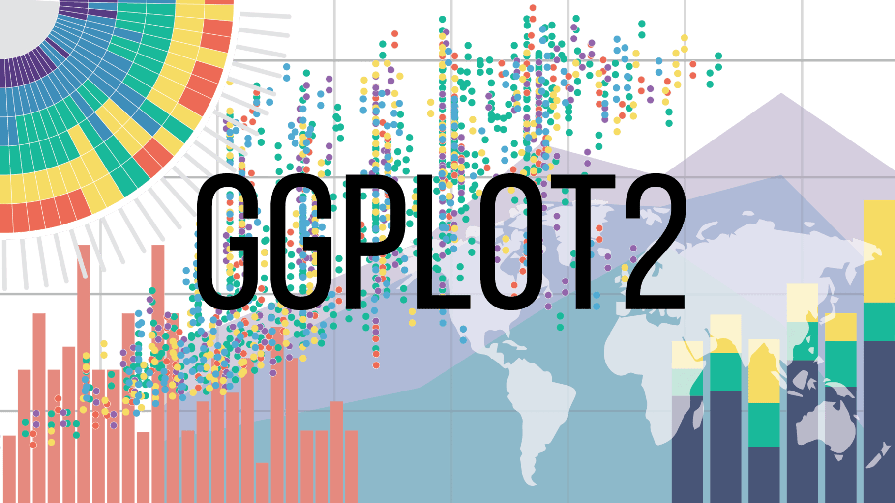
<p><b>P2</b> | Data exploration and visualization</p>
</div>
<div>
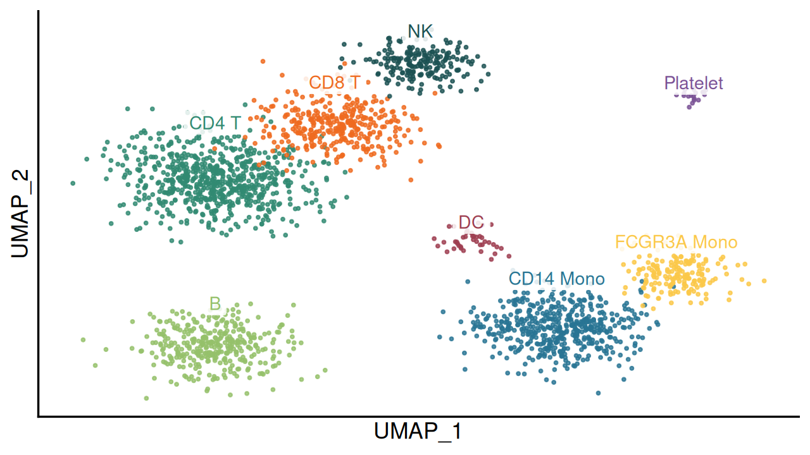
<p><b>P3</b> | Single-cell analysis with Seurat</p>
</div>
<div>
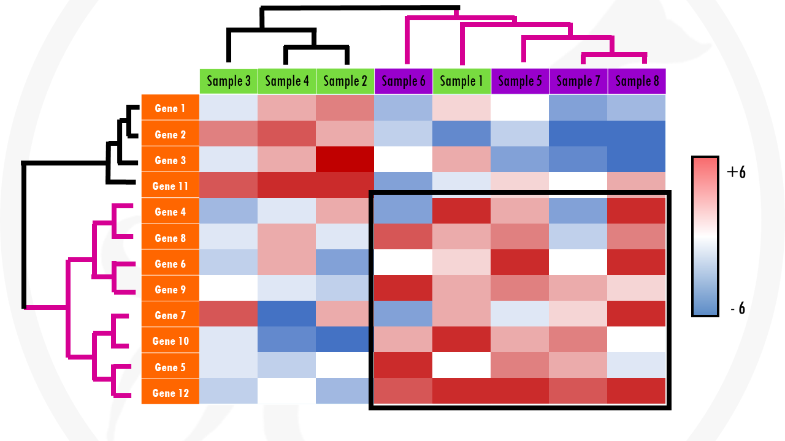
<p><b>P4</b> | Differential gene expression analysis</p>
</div>
]

---
class: animated, fadeIn

## Contents (P1-P4)

.pull-left[

- Introduction to the practical's content

- Jupyter Notebook or R Markdown document with the practical's guide

- UAB computers have all the required software and tools

> How can I install Git? Anaconda? R and RStudio? Using Linux on Windows? see section 03

]

.pull-right[
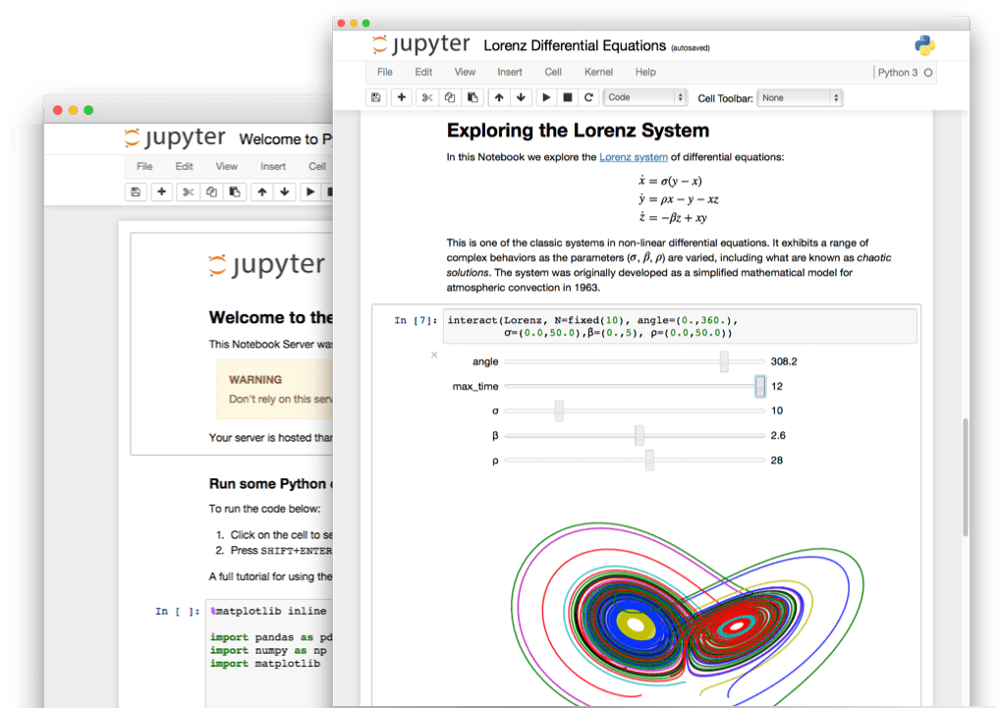
]

---
class: animated, fadeIn

## P1 | Data management and processing

_Part 1 | Basics on Bioinformatics workflows: transforming data into insight_


In this practical you will learn the basic commands of Linux. Getting familiar with these commands is key in bioinformatics, as many pipelines rely on the combination of different tools through a terminal. In addition, biological data are stored in large text files that can be easily processed using Linux.

#### Learning outcomes

- Get familiar with the Unix directories

- Learn basic text-processing Linux commands and piping

- Use the Linux command line to perform tasks on the data

---
class: animated, fadeIn

## P2 | Data exploration and visualization

_Part 1 | Basics on Bioinformatics workflows: transforming data into insight_


Why is data visualization so important for researchers? You can turn data into meaningful information.

#### Learning outcomes

- Learn the grammar of graphics of `ggplot2`

- Create the most common bioinformatics graphs (scatterplots, line plots, barplots, ...)

- Understand the important elements of a ready-to-publish figure


---
class: animated, fadeIn

## P3 | Differential gene expression analysis

_Part 1 | Solving real cases in genomics_


**Identifying differentially expressed genes in cancer**

RNA-seq is an approach to carry out expression profiling using high-throughput sequencing technologies. In this practical, we walk through a gene-level RNA-seq differential expression analysis to find genes over- or under-expressed in control vs. patients.

#### Learning outcomes

- Data manipulation (P1) and visualization (P2)

- Descriptive analysis of the data (P1)

- Find which genes are differentially expressed using `DESeq2` and perform an enrichment analysis

---
class: animated, fadeIn

## P4 | Single-cell analysis with Seurat

_Part 2 | Solving real cases in genomics_


**Identifying cell types from single-cell RNA-seq data**

Single-cell RNA-seq (scRNA-seq) measures gene expression in thousands of individual cells, revealing the cellular heterogeneity that bulk RNA-seq averages out. In this practical, we will use the R package `Seurat` to go from a raw count matrix to an annotated map of the cell types present in a tissue.

#### Learning outcomes

- Understand the structure of scRNA-seq data (count matrix, `Seurat` object) and perform quality control of cells

- Apply the standard workflow: normalization, selection of highly variable genes, scaling and dimensionality reduction (PCA, UMAP)

- Cluster cells and identify marker genes for each cluster

- Annotate clusters into cell types using known markers

---
layout: false
class: left, bottom, inverse, animated, bounceInDown

# 03

## First task: get together

Groups organization, creation of the GitHub repository, required tools

---
class: animated, fadeIn

## Setting up a GitHub repository

[Create an account in GitHub](https://github.com/join): one for each member of the group. **Only one** of the accounts must follow the next steps:

1. In the top left part of the page, click on 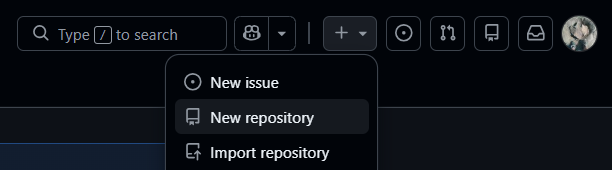 to create a **new repository**.

2. Write a short and easy-to-remember name for your new repository:

<center>
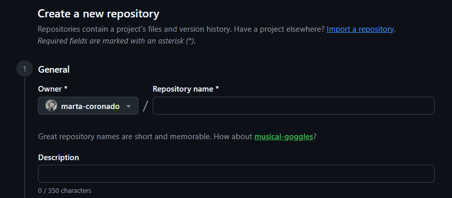
</center>

---
class: animated, fadeIn

## Setting up a GitHub repository

<ol start="3"><li><p>Add a description for your repository, including the names of the group members.</p></li></ol>

<center>
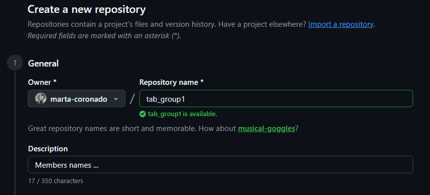
</center>

--

<ol start="4"><li><p>Make your repository <strong>private</strong>.</p></li></ol>

<center>
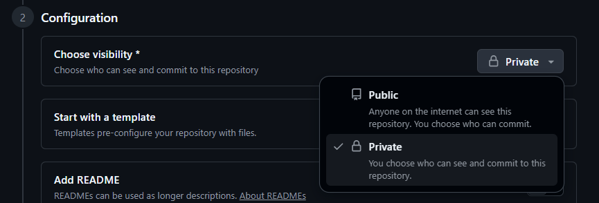
</center>

---
class: animated, fadeIn

## Setting up a GitHub repository

<ol start="5">
<li><p>Select <strong>Initialize this repository with a README</strong>.</p></li>
<li><p>Click on <strong>Create repository</strong>.</p></li>
</ol>

<center>
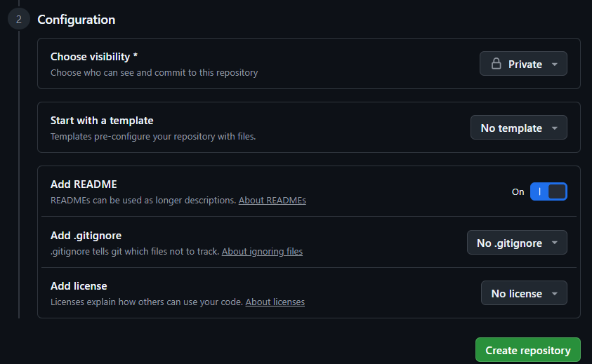
</center>

---
class: animated, fadeIn

## Setting up a GitHub repository

<ol start="7"><li><p>Add the rest of the group members as collaborators under <strong>Settings &gt; Collaborators</strong>. Also, add me as a collaborator (<code class="remark-inline-code">marta-coronado</code>).</p></li></ol>

<center>
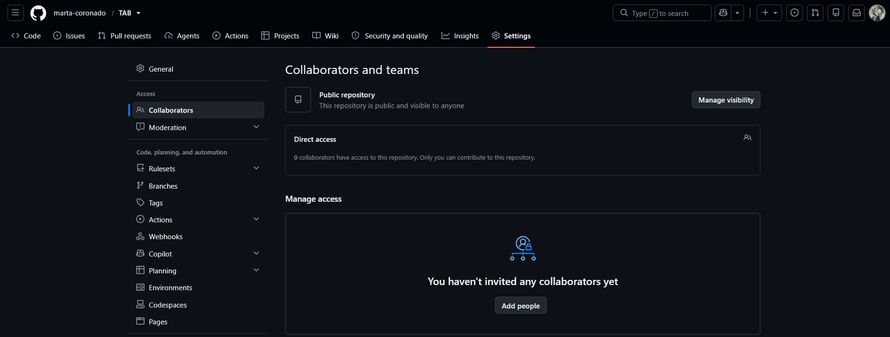
</center>

---
class: animated, fadeIn

## Using GitHub

**Keep your GitHub updated**:

- By using the browser version (recommended)

<center>
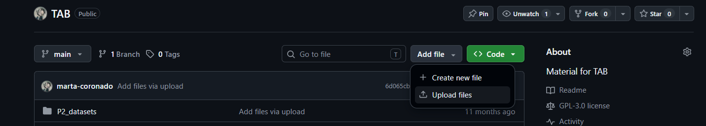
</center>

- or with the command line if you use a UNIX system

--

Install `git` on your computer (all group members can install it):

```bash
sudo apt install git
```

---
class: animated, fadeIn

## Using GitHub

.pull-left[

- Go to a directory in which you want to clone your repository (e.g. a Desktop folder)

- Open a terminal and write `git clone` followed by the link to your repository (you can find it by clicking on the **Code** button)

```bash
git clone https://github.com/USER-NAME/REPOSITORY-NAME.git
```

- This command will download the project into a folder named as the repository

- You can use this folder as a regular one on your computer (create folders, copy files, etc.)

]

.pull-right[
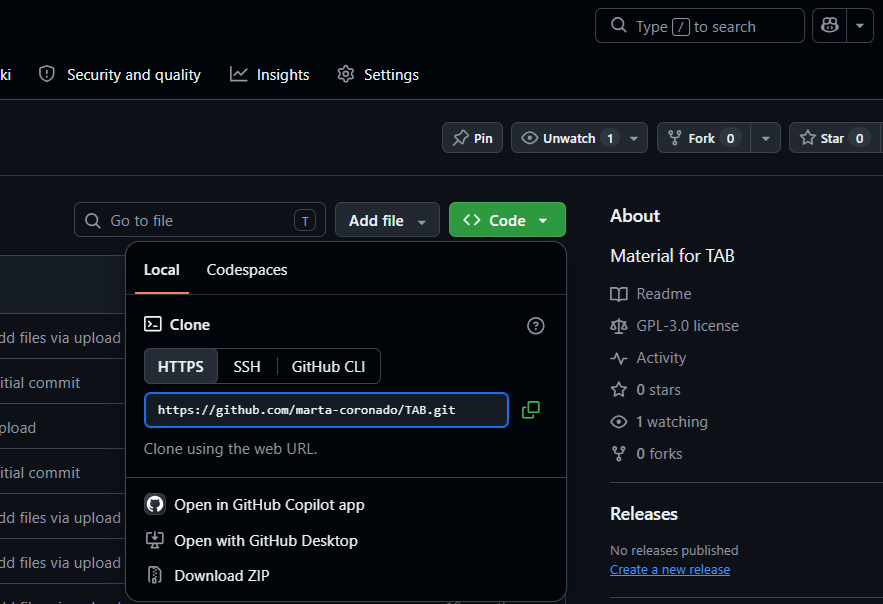
]

---
class: animated, fadeIn

## Using GitHub: basic commands

Before making any change, first of all execute `git pull` to update the repository to the most recent version:

```bash
git pull
```

--

After finishing, add all the files that will be uploaded:

```bash
git add --all
```

--

Comment all the changes that you have made:

```bash
git commit -m "Comment"
```

--

To send all the changes:

```bash
git push
```

---
class: animated, fadeIn

## Install conda

We recommend using Linux (or UNIX), but a good solution is to install Ubuntu under Windows.

1. Download the installer:
   - [Miniconda (Linux 64 bits)](https://repo.anaconda.com/miniconda/Miniconda3-latest-Linux-x86_64.sh)
   - [Anaconda (Linux 64 bits)](https://repo.anaconda.com/archive/Anaconda3-2023.09-0-Linux-x86_64.sh)

2. Install it through the terminal:

```bash
bash Miniconda3-latest-Linux-x86_64.sh
```

<ol start="3">
<li><p>Follow the instructions that you'll see on screen. Leave everything by default.</p></li>
<li><p>Restart the console once finished.</p></li>
</ol>

> Everything is available at the computer room!

---
class: animated, fadeIn

## Install R and RStudio

- You can get R from: https://cran.r-project.org

- You can download RStudio from: https://docs.posit.co/ide/user/download.html

- R and RStudio are available for Windows, Linux and macOS for free.

- Practicals need some R libraries installed; they are specified in the practical document.

> Everything is available at the computer room!

---
class: animated, fadeIn

## LaTeX

A nice template for your reports: https://www.overleaf.com/read/vchzpswtycyg

.pull-left[
<center>
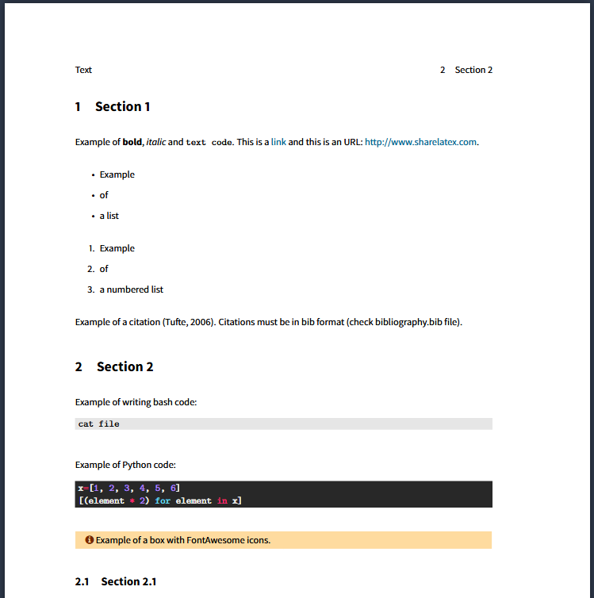
</center>
]

.pull-right[
<center>
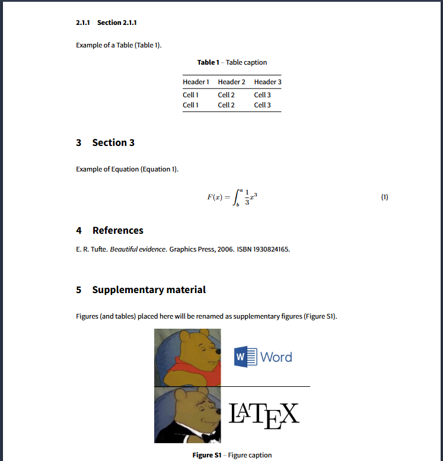
</center>
]

---
class: animated, fadeIn

## Get together: TO DO

<i class="fa-regular fa-square"></i> Organize your group and enroll at the Campus Virtual: [link](https://e-aules.uab.cat/2026-27/mod/groupselect/view.php?id=58044)

<i class="fa-regular fa-square"></i> Create [GitHub accounts](https://github.com/signup) for all members

<i class="fa-regular fa-square"></i> Create [a repository in GitHub](https://github.com/new)

<i class="fa-regular fa-square"></i> Add all group members (and me! <code class="remark-inline-code">marta-coronado</code>) as collaborators

<i class="fa-regular fa-square"></i> Write general questions to ask our speakers in the [forum](https://e-aules.uab.cat/2026-27/mod/forum/discuss.php?d=11963)


---
class: animated, fadeIn

## Contact

<center>
**Marta Coronado Zamora**

Departament de Genètica i de Microbiologia (UAB)

<i class="fa-solid fa-paper-plane"></i> <a href="mailto:marta.coronado@uab.cat">marta.coronado@uab.cat</a><br>
<i class="fa-brands fa-bluesky"></i> @geneticament.bsky.social &nbsp; <i class="fa-brands fa-github"></i> @marta-coronado
</div>
